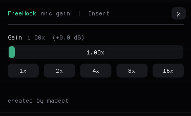

# FreeHook — Discord Opus Mic Gain Hook

Хук микрофона для Discord: крутилка усиления (gain), и всё. Открытый исходник.
**created by madect**

<p align="center">
  
</p>

## Что это

DLL цепляется к функции кодирования голоса в `discord_voice.node` и домножает
твой PCM на коэффициент **до** Opus — тебя слышат громче, обработка на твоей
стороне.

## Как работает

- `injector.exe` ищет процесс `Discord.exe` с загруженным `discord_voice.node`
  (значит ты в войсе) и грузит `hookdll.dll` через `CreateRemoteThread` +
  `LoadLibraryW`.
- `hookdll.dll` ставит хук на `WebRtcOpus_Encode_wrapper` через
  [MinHook](https://github.com/TsudaKageyu/minhook).
- В перехвате каждый сэмпл умножается на `gain`, клампится в `int16`, дальше
  зовётся оригинал.
- Адрес ищется по RVA от базы модуля, а если версия Discord другая — сканом по
  сигнатуре пролога (первое уникальное совпадение). Окно — Dear ImGui на DX11.

## Адрес и сигнатура

```
модуль:  discord_voice.node

WebRtcOpus_Encode_wrapper
  RVA:   0x713280
  proto: int __fastcall (
             void*    opus_inst,            // RCX
             int16_t* pcm,                  // RDX  — буфер для правки
             uint64_t samples_per_channel,  // R8
             int      max_encoded_bytes,    // R9
             uint8_t* encoded_out)          // stack
  пролог (16 байт):
    56 57 48 83 EC 28 BF FF FF FF FF 49 81 F8 80 16

  каналы:    opus_inst + 0x10 (uint64, 1..8)
  размер:    samples_per_channel * channels
```

RVA версионно-зависим: если не сошлось — работает скан по сигнатуре; если
пролог поменялся, обнови байты под свою версию `discord_voice.node`.

## Сборка

Visual Studio Build Tools (MSVC + Windows SDK), путь к `vcvars64.bat` —
переменная `VCVARS` в `build.bat`.

```cmd
cd C:\...\freehook
build.bat
```

Выход: `build\hookdll.dll`, `build\injector.exe`.

## Запуск

1. Открой Discord и зайди в голосовой канал.
2. Запусти `injector.exe`.
3. Окно **FreeHook** появится поверх Discord. **Insert** — скрыть/показать,
   **X** — снять хук и выгрузить DLL.
